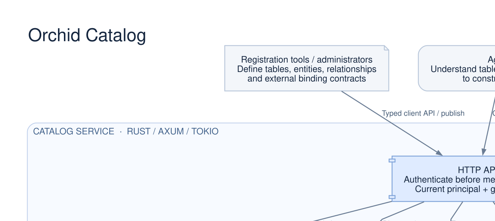

# Catalog architecture



[SVG](01-system.svg) · [PNG](01-system.png) · [Graphviz source](01-system.dot)

The catalog registers and versions metadata, publishes immutable releases, and
checks current grants for discovery and manifest reads. Consumers use the published definitions to bind their own data sources.

Arrows indicate requests and storage operations; responses are omitted.
Document icons represent definitions and metadata, component icons represent
service interfaces, and the cylinder represents the catalog database.

To regenerate this diagram with Graphviz installed:

```sh
docs/architecture/render.sh
```
